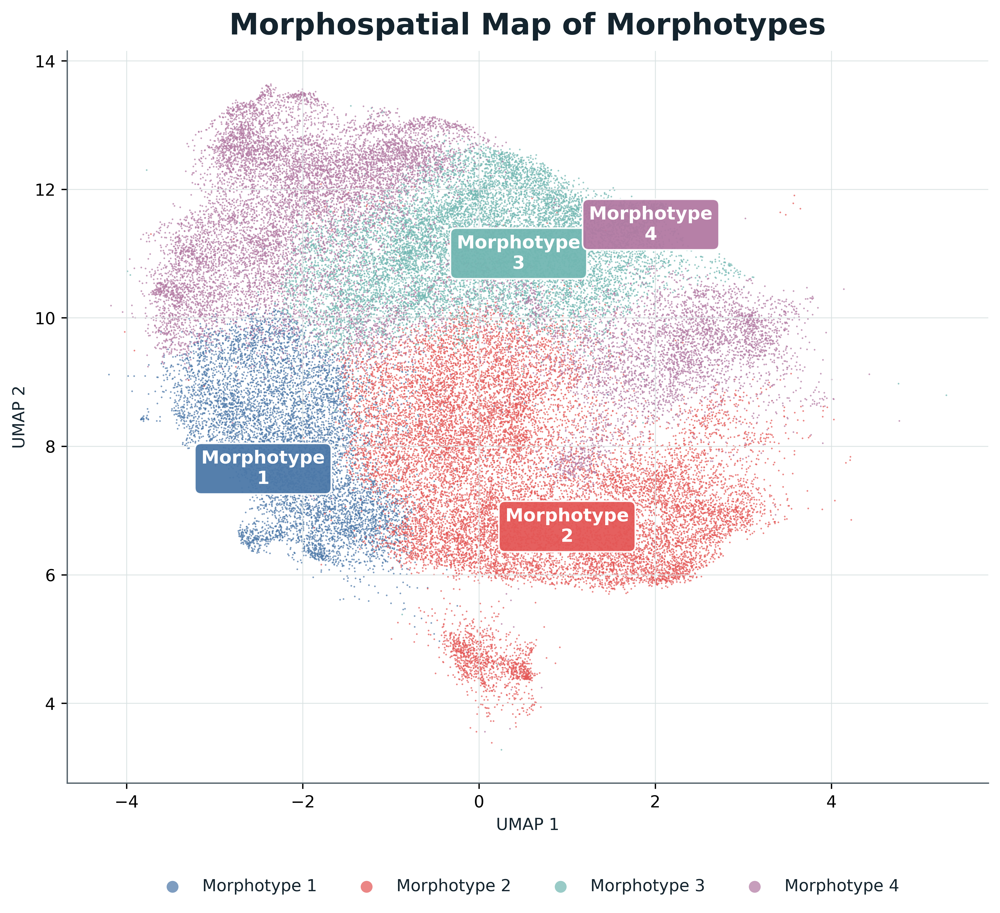

# OvaPredict

OvaPredict is an early-stage computational pathology research project that investigates whether unsupervised artificial intelligence can turn multiplex immunofluorescence images of ovarian tumors into quantitative morphospatial profiles.

> **Research status:** experimental proof of concept (TRL 3). This is not a clinical decision-support system, a validated diagnostic test, or a medical device.

## Purpose

Ovarian tumors can display substantial intratumoral heterogeneity, which makes reproducible characterization of tissue patterns challenging. OvaPredict explores an unsupervised workflow to identify morphospatial phenotypes from multiplex immunofluorescence images and study their association with diagnostic categories and protein-biomarker signals.

The project is presented here as a scientific communication record. It is deliberately limited to authorized conference material and high-level context.

## What this private repository contains

- The approved English conference abstract.
- Authorized, de-identified presentation figures.
- Plain-language scientific context, current status, and a validation-oriented roadmap.
- Repository safeguards that prevent accidental inclusion of restricted material.

## What it never contains

- Patient-level data, clinical records, identifiers, or raw image files.
- Raw, derived, or tabular study data; metadata; or embeddings.
- Model weights, trained checkpoints, model artifacts, or executable research code.
- Credentials, access tokens, or unpublished materials.

See [Data and model governance](docs/data-and-model-governance.md) for the complete rules.

## Preliminary findings reported in the 2026 conference abstract

The reported proof of concept analyzed multiplex immunofluorescence images from a cohort of 48 patients and processed 72,017 tissue regions. Four dominant morphospatial phenotypes were identified. When summarized as patient-level proportions, these profiles were associated with diagnostic category across the benign–borderline–malignant spectrum. In particular, one phenotype increased and another decreased across that spectrum. Exploratory analyses also found partial associations with biomarker signals.

These findings are preliminary, aggregate research results. They do not establish clinical performance or utility.

## Figures

The figures below are authorized congress-poster graphics. They communicate aggregate findings only and carry no patient identifiers.

| Workflow | Morphospatial map | Diagnostic gradient |
| --- | --- | --- |
|  |  |  |

For descriptions and the complete approved figure set, see [Figure guide](docs/figures.md).

## Current status and next steps

OvaPredict remains at TRL 3. The appropriate next stages are external-cohort validation, expert pathology review of the phenotypes, and assessment against meaningful clinical outcomes. These are validation goals—not completed capabilities. See [Current status and roadmap](docs/status-and-roadmap.md).

## Materials and attribution

The scientific content in this repository is based on the authorized 2026 congress abstract by T. A. Herrador, Y. Rodriguez, N. Lujea, and P. Kunda, affiliated with the Instituto Universitario de Ciencias Biomédicas de Córdoba (IUCBC) and CIMETSA U.A. CONICET.

No permission to redistribute, reuse, or derive work from these materials is granted by default. See [NOTICE.md](NOTICE.md).
