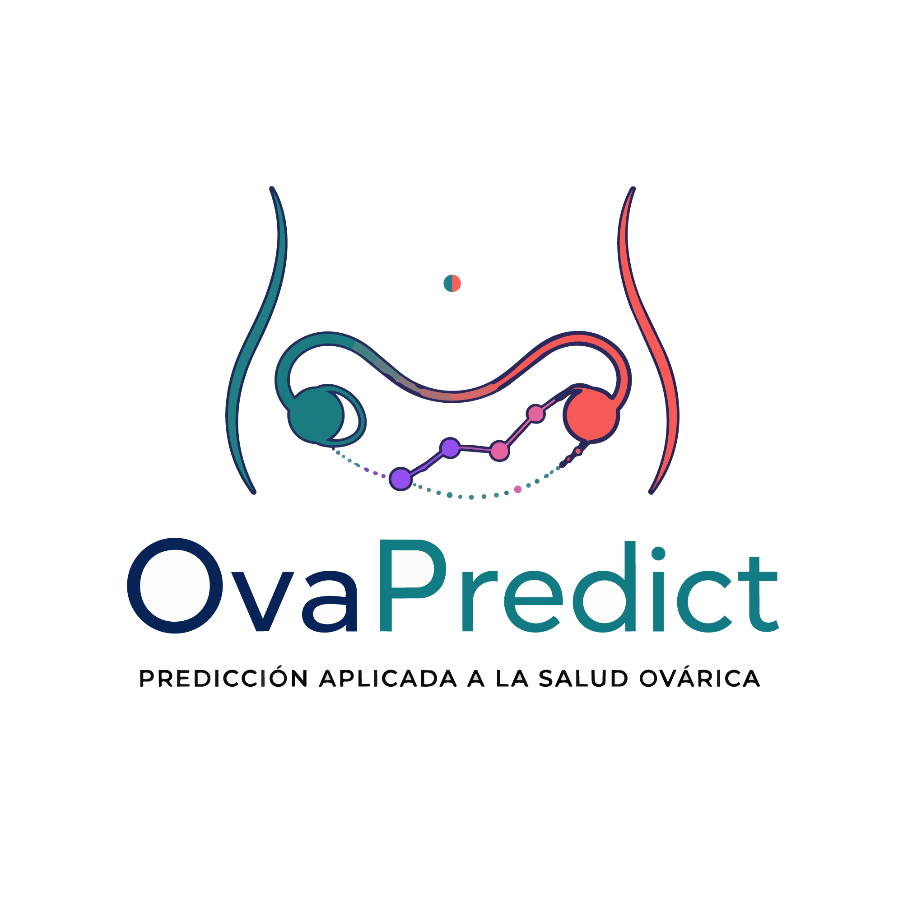
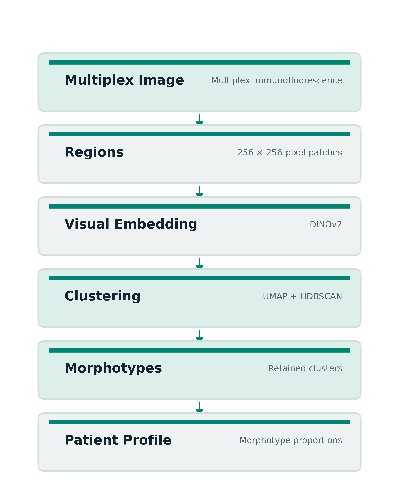
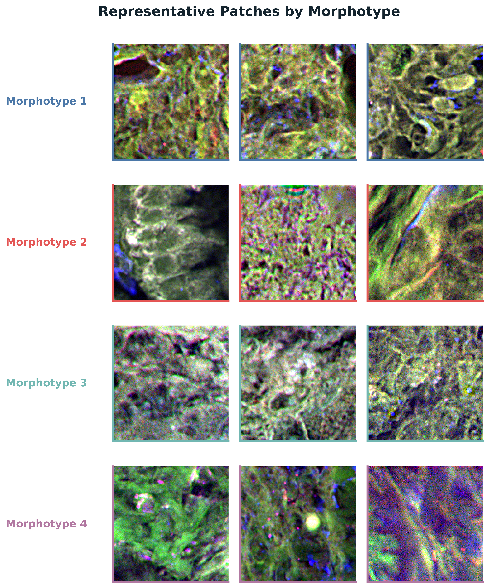
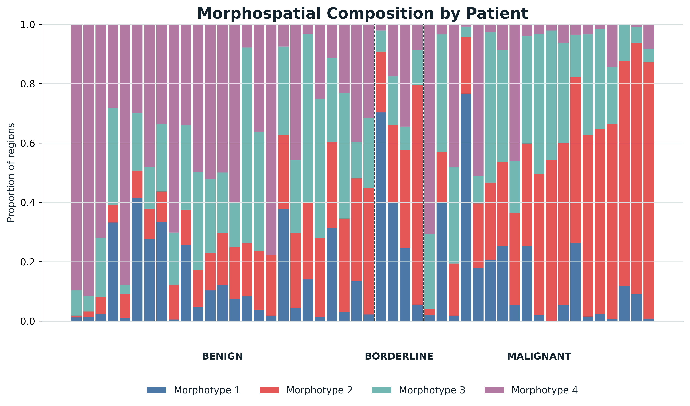
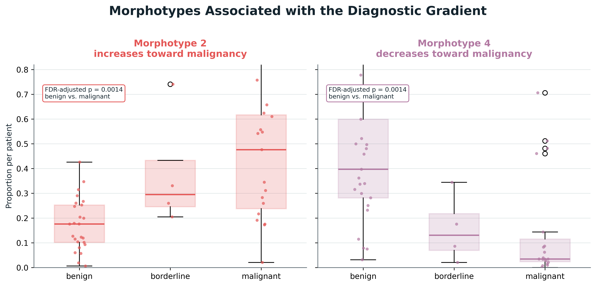
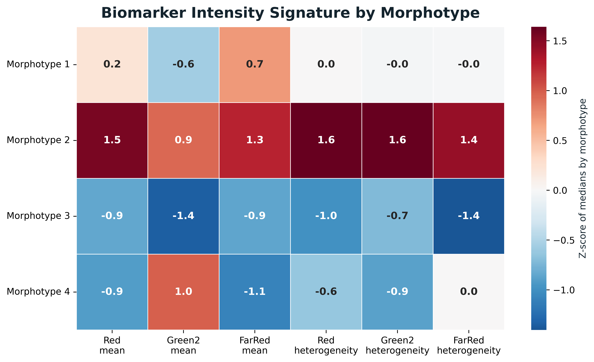

  

# OvaPredict – reading ovarian cancer through the patterns in its tissue

> **Early-stage research, shared while it grows. It is not a clinical tool.** The data are not public, so this page shows the idea and anonymised figures only: no patient data, tissue images, code or models.

## What this project is

Ovarian cancer is not a single, uniform disease. One tumour can contain regions with different shapes, organisation and molecular signals, which makes tissue hard to describe consistently, hard to compare between cases, and hard to connect with the biology behind the disease.

OvaPredict is a team project that brings together computational pathology, artificial intelligence and translational oncology to make those patterns measurable. We are not trying to replace the pathologist. The aim is to add a quantitative layer to what a pathologist sees, so that a complex tissue image becomes a set of questions that are easier to ask and, eventually, to test.

The questions we are working on are:

1. **Can tissue be described by a small number of recurring patterns,** found without telling the algorithm what to look for?
2. **Do those patterns make sense when you look at the tissue** behind them?
3. **Does the balance of patterns change** between benign, borderline and malignant tumours?
4. **Do the patterns carry a measurable molecular signature?**

**My role:** data scientist and developer of the project.

## The short version

| Question | What we see so far |
|---|---|
| Are there recurring patterns? | **It looks like it.** Our early work suggests that the tissue organises into a small number of recurring patterns, which we call morphotypes. |
| Do they make sense in the tissue? | **We can check.** For each pattern we go back to representative patches of tissue, so the grouping can be reviewed by eye instead of trusted as a black box. |
| Do they change with the diagnosis? | **Some seem to.** Preliminary analyses suggest that some patterns shift along the benign, borderline and malignant spectrum. For now that is a hypothesis to validate, not a diagnostic signal. |
| Do they carry a molecular signature? | **We are exploring it.** We are looking at whether each pattern has its own marker-intensity profile, without claiming a biomarker. |
| Where is the project now? | **Proof of concept.** We presented it in September 2026; the next step is to validate the patterns in independent cohorts. |

## How it works

We work with **multiplex immunofluorescence**, a technique that shows several proteins in the same tissue sample. Instead of starting from a fixed diagnosis, we cut each image into many small tissue regions and let an **unsupervised** algorithm look for patterns that keep coming back. Then we bring the regions of each case together into a **morphospatial profile**: a quantitative portrait of how those patterns are distributed in that tumour.

## Following the project step by step

<b>Show the five steps</b> (the map of patterns, back to the tissue, each case as a profile, the diagnostic spectrum, a molecular signature)

### 1. A map of the patterns

On this map, regions that look alike sit close together and regions that look different sit apart. We use it to inspect the structure that comes out of the images before giving it any biological meaning.

### 2. Back to the tissue

A pattern is more than a number: for each one we can go back to the images and look at representative, de-identified patches. This is what makes the grouping auditable, because it lets a pathologist judge whether a pattern looks coherent.

### 3. Each case as a profile

When we summarise the patterns as proportions, each case becomes a profile rather than a single image. In this figure every bar is unlabelled and there is no clinical or patient information; it shows how the balance between patterns can vary across the benign, borderline and malignant spectrum.

### 4. Patterns along the diagnostic spectrum

Our preliminary analyses suggest that some patterns change along that spectrum. We read this carefully: it is an early research signal, not a diagnosis, a prognosis or a treatment recommendation. What it gives us today is a concrete hypothesis to test on independent material, with pathologists.

### 5. A molecular signature?

We are also looking at whether each pattern keeps a measurable marker signature. This is where the image and the molecular information can start to speak to each other. The goal is not to claim a clinical biomarker yet, but to learn whether the patterns the algorithm finds are linked to biological features we can quantify.

## Things to keep in mind

- **It is a proof of concept.** Everything here is preliminary and has not been tested on an independent cohort.
- **The patterns are found by an unsupervised method,** so their biological meaning still has to be established with pathologists.
- **Nothing here is a diagnosis, a prognosis or a treatment recommendation.**
- **What this repository does not contain:** patient data, identifiers, clinical metadata, raw tissue images, model weights, source code or unpublished results. The figures are de-identified summaries made for communication, and the underlying data cannot be reconstructed from them.

## Where it was presented, and what comes next

We presented OvaPredict in September 2026 at the [2nd International Congress of Biotechnology](https://www.unc.edu.ar/sites/default/files/Libro%20de%20Resumenes%20del%202%20Congreso%20de%20Biotecnologia%20UNC%202026.pdf) at the National University of Córdoba, Argentina, where we discussed it with people working in biotechnology, health and digital technologies.

Next, we want to validate the patterns in independent cohorts, discuss what they mean with pathology experts, and study whether they connect with clinical outcomes. Every step towards the clinic has to be scientifically sound, clinically responsible and respectful of the people behind the samples.
